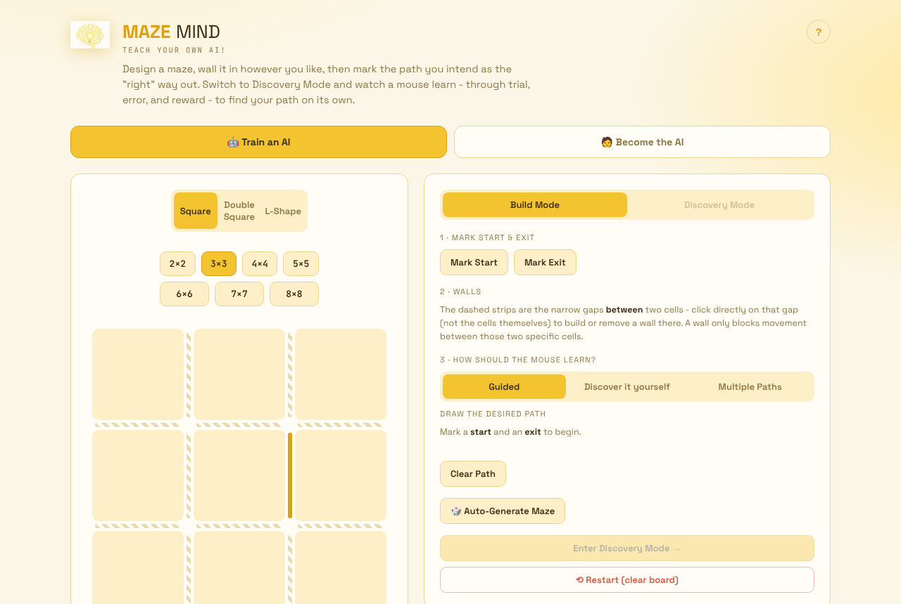

<div align="center">


# Maze Mind

**Teach your own AI.**

[](https://serjdmitri.github.io/MazeMind/maze-mind-v2_9_16.html)
[](LICENSE)
[](#tech-stack)

</div>

Maze Mind is an interactive, single-file web app that teaches reinforcement learning through maze solving. Build a maze, choose how the agent gets rewarded, then watch a mouse learn through trial, error, and reward to find the cheese on its own.

There is no backend and no dependencies. The whole app is one HTML file that runs in the browser.



## Features

### Train an AI

Design a maze, or generate one, and train a Q-learning agent to solve it. Pick from three reward schemes:

| Mode | What the agent gets |
| --- | --- |
| **Guided** | You draw the path you want. The mouse is rewarded for staying on it and penalized for straying. It never sees the path, only the reward signal. |
| **Discover it yourself** | No path. A flat cost per step and a large reward at the exit, so the agent has to find an efficient route on its own. |
| **Multiple Paths** | More than one valid route exists. The shortest route pays the most, and longer valid routes pay progressively less. |

Run episodes one at a time or train in bulk. The results dashboard tracks episodes, success rate, points, a learning curve, and a run log. Advanced controls let you tune the learning rate, exploration rate, and scoring. A speed slider goes from Normal to Instant, and you can change it mid-run. Save and reload trained agents at any time.

### Become the AI

Flip the experience and play the maze yourself. Walls stay hidden until you bump into them, just like the mouse discovers them. Earn and lose points the same way the AI does. Complete a maze with zero errors to log a clean solve, then save your fastest times to a leaderboard.

### Maze options

- **Shapes:** Square, Double Square, and L-Shape, each with independent size controls
- **Build or generate:** draw your own walls, or auto-generate a maze
- **Live charts:** time-to-finish across runs, per shape, so you can watch the agent (or yourself) get faster

## Quick start

**Option 1: Use the live demo.** Open the [hosted version](https://serjdmitri.github.io/MazeMind/).

**Option 2: Open it locally.** Clone the repo and open the app file in any modern browser:

```bash
git clone https://github.com/serjdmitri/MazeMind.git
cd MazeMind
open maze-mind-v2_9_16.html    # macOS; on Windows, double-click the file
```

Your saved agents and leaderboard times are stored in `localStorage`, so they stay in the browser you used.

## Tech stack

- Pure HTML, CSS, and vanilla JavaScript
- No frameworks, no build step, no external libraries
- Q-learning implemented from scratch in the browser
- Progress (saved agents, leaderboard times) persisted with `localStorage`
- Deployed to GitHub Pages by the workflow in [`.github/workflows/static.yml`](.github/workflows/static.yml)

## Project structure

```
MazeMind/
├── maze-mind-v2_9_16.html   # The entire app (HTML, CSS, JS, embedded images)
├── index.html               # Redirects the site root to the app
├── assets/
│   ├── logo.png             # Logo, original size
│   ├── logo-transparent.png # Logo with a transparent background, for dark surfaces
│   └── team/                # Team photos used on the About screen
├── docs/screenshots/        # Screenshots used in this README
├── .github/workflows/       # GitHub Pages deployment
└── LICENSE
```

The app embeds its images as base64, so the HTML file does not depend on image hosting. The files in `assets/` are those same images, extracted for the README and other repo material.

## Team

<table>
  <tr>
    <td align="center"><br><b>Ally Rogin</b></td>
    <td align="center"><br><b>Lizzy Chu</b></td>
    <td align="center"><br><b>Sergey Dmitriev</b></td>
    <td align="center"><br><b>Bernardo Dias Martins</b></td>
  </tr>
</table>

## License

Released under the [MIT License](LICENSE).
