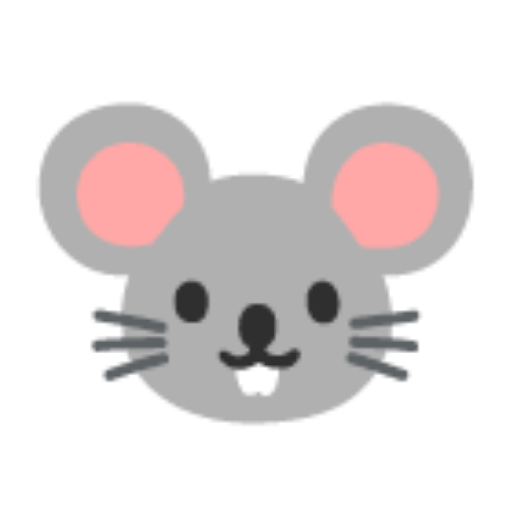
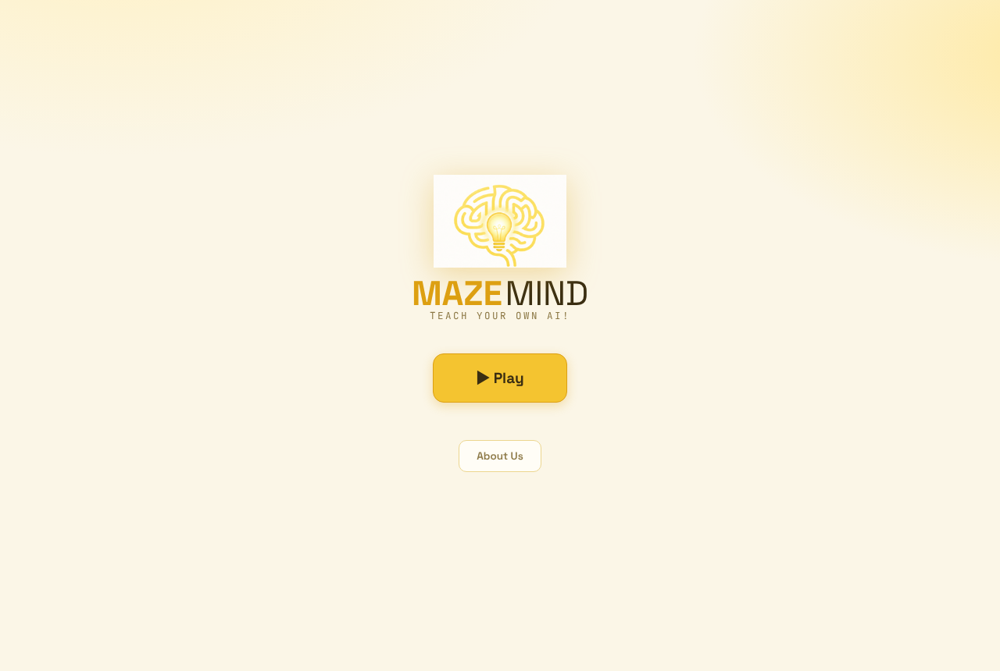
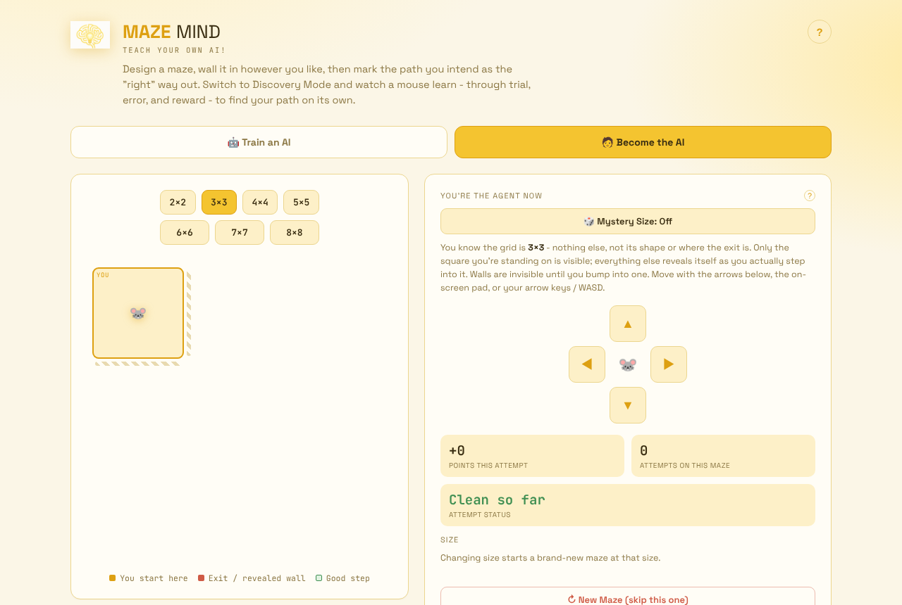

<div align="center">



# Maze Mind

**Teach your own AI.**

An interactive maze where you build the puzzle, pick the reward, and watch a mouse learn to find the cheese by trial and error.

[](maze-mind-v2_9_16.html)
[](#quick-start)
[](#tech-stack)
[](#tech-stack)
[](LICENSE)

[Play the live demo](https://serjdmitri.github.io/MazeMind/maze-mind-v2_9_16.html) · [Quick start](#quick-start) · [Features](#features) · [Contributing](#contributing)

<br>


<sub><i>Build a maze, choose a reward scheme, and train the mouse.</i></sub>

</div>

<br>

Maze Mind turns reinforcement learning into something you can see. Design a maze, choose how the agent gets rewarded, then watch it learn through trial, error, and reward. Or flip the experience and solve the maze yourself, one bump at a time.

It is a single HTML file with no backend and no build step. Everything runs in your browser.

<p align="center">
  
  &nbsp;
  
</p>

<p align="center"><sub>Left: home screen. Right: Become the AI mode, where you are the agent.</sub></p>

> **Status:** Maze Mind is a single-file web app deployed with GitHub Pages. It has no installer and no accounts. Saved agents and leaderboard times live in your browser's `localStorage`, so they stay on the device you used.

## Features

### Train an AI

Design a maze, or generate one, and train a Q-learning agent to solve it. Pick from three reward schemes:

| Mode | What the agent gets |
| --- | --- |
| **Guided** | You draw the path you want. The mouse is rewarded for staying on it and penalized for straying. It never sees the path, only the reward signal. |
| **Discover it yourself** | No path. A flat cost per step and a large reward at the exit, so the agent has to find an efficient route on its own. |
| **Multiple Paths** | More than one valid route exists. The shortest route pays the most, and longer valid routes pay progressively less. |

Run episodes one at a time or train in bulk. The results dashboard tracks episodes, success rate, points, a learning curve, and a run log. Advanced controls let you tune the learning rate, exploration rate, and scoring. A speed slider goes from Normal to Instant, and you can change it mid-run. Save and reload trained agents at any time.

### Become the AI

Flip the experience and play the maze yourself. Walls stay hidden until you bump into them, just like the mouse discovers them. Earn and lose points the same way the AI does. Complete a maze with zero errors to log a clean solve, then save your fastest times to a leaderboard.

### Maze options

- **Shapes:** Square, Double Square, and L-Shape, each with independent size controls
- **Build or generate:** draw your own walls, or auto-generate a maze
- **Live charts:** time-to-finish across runs, per shape, so you can watch the agent (or yourself) get faster

## Quick start

**Option 1: Use the live demo.** Open the [hosted version](https://serjdmitri.github.io/MazeMind/).

**Option 2: Open it locally.** Clone the repo and open the app file in any modern browser:

```bash
git clone https://github.com/serjdmitri/MazeMind.git
cd MazeMind
open maze-mind-v2_9_16.html    # macOS; on Windows, double-click the file
```

Your saved agents and leaderboard times are stored in `localStorage`, so they stay in the browser you used.

## Tech stack

- Pure HTML, CSS, and vanilla JavaScript
- No frameworks, no build step, no external libraries
- Q-learning implemented from scratch in the browser
- Progress (saved agents, leaderboard times) persisted with `localStorage`
- Deployed to GitHub Pages by the workflow in [`.github/workflows/static.yml`](.github/workflows/static.yml)

## Project structure

```
MazeMind/
├── maze-mind-v2_9_16.html   # The entire app (HTML, CSS, JS, embedded images)
├── index.html               # Redirects the site root to the app
├── assets/
│   ├── mouse-logo.png       # Mouse mark used in this README
│   ├── logo.png             # Brain-and-lightbulb logo, original size
│   ├── logo-transparent.png # Brain logo with a transparent background
│   └── team/                # Team photos used on the About screen
├── docs/screenshots/        # Screenshots used in this README
├── .github/workflows/       # GitHub Pages deployment
└── LICENSE
```

The app embeds its images as base64, so the HTML file does not depend on image hosting. The files in `assets/` are those same images, extracted for the README and other repo material.

## Team

<table>
  <tr>
    <td align="center"><br><b>Ally Rogin</b></td>
    <td align="center"><br><b>Lizzy Chu</b></td>
    <td align="center"><br><b>Sergey Dmitriev</b></td>
    <td align="center"><br><b>Bernardo Dias Martins</b></td>
  </tr>
</table>

## Contributing

Issues and pull requests are welcome. Because the app is a single HTML file, keep changes inside `maze-mind-v2_9_16.html` unless a change clearly needs a new file. Open the file in a browser and test your change in both modes before you submit.

## Credits

- Mouse mark: the 🐭 emoji from Google's Noto Color Emoji font, rendered to PNG.
- Brain-and-lightbulb logo and team photos: from the About screen in the app.

## License

Released under the [MIT License](LICENSE).
